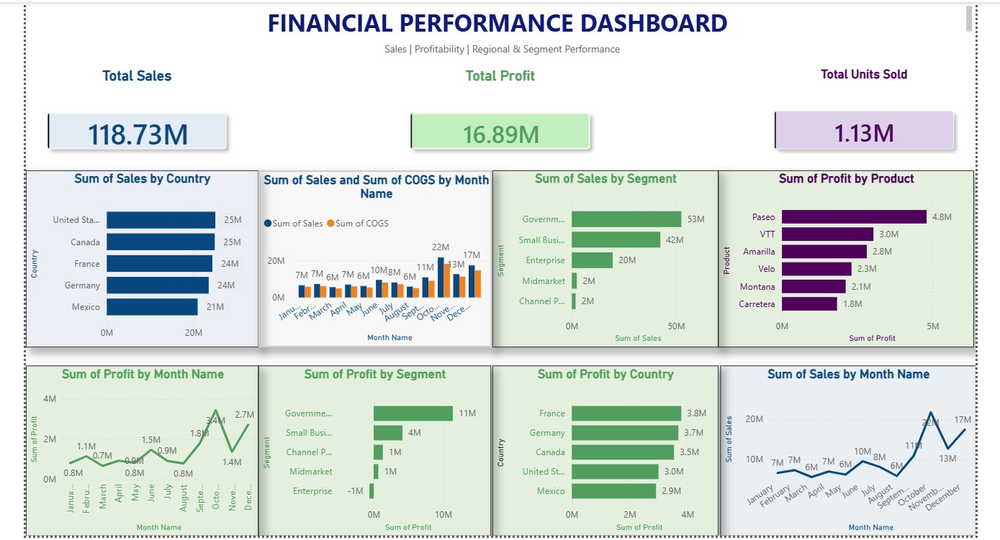
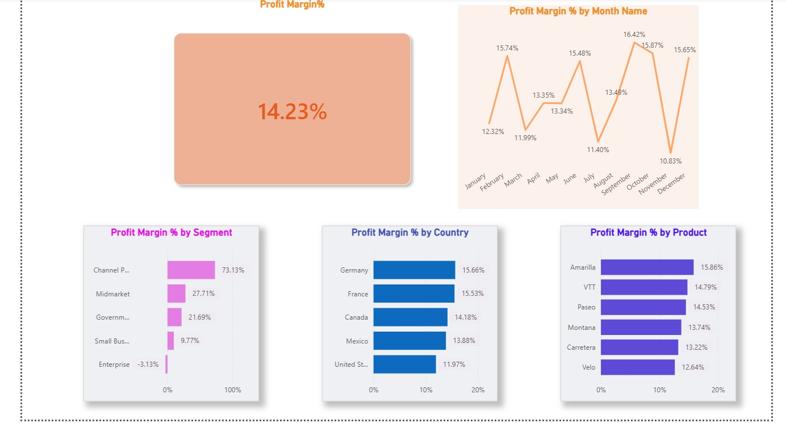

# Financial Analysis – Excel & Power BI

1. Project Overview

This project focuses on financial analysis using Excel and Power BI. It explores business performance through key financial metrics, including Sales, Profit, Cost of Goods Sold (COGS), Units Sold, and Profit Margin.

The analysis examines financial performance across different countries, products, business segments, and time periods.

The objective is to transform raw financial data into meaningful insights and interactive dashboards that support data-driven business decisions.

2. Business Problem Statement

Understanding financial performance is essential for evaluating business growth and profitability.

This project aims to answer key business questions:

- How are sales and profits performing across different countries?
- Which products and business segments generate the highest profit?
- How do sales and profit change over time?
- How does profitability vary across countries, products, and segments?
- What is the relationship between Sales and Cost of Goods Sold?

3. Dataset Summary

The project uses the Financial Sample dataset containing 700 records and 16 columns.

The dataset includes:

- Segment
- Country
- Product
- Discount Band
- Units Sold
- Manufacturing Price
- Sale Price
- Gross Sales
- Discounts
- Sales
- COGS
- Profit
- Date
- Month Number
- Month Name
- Year

4. Tools and Technologies

- Microsoft Excel
- Power BI
- DAX (Data Analysis Expressions)

5. Project Workflow

1. Imported and inspected the financial dataset.
2. Reviewed the available columns and financial metrics.
3. Prepared the dataset for financial analysis.
4. Analyzed sales, profit, and profitability across different business dimensions.
5. Created financial measures and KPIs using Power BI.
6. Developed interactive dashboards to present business performance.
7. Identified key financial trends and performance patterns.

6. Key Business Insights

The financial analysis highlights the following overall performance metrics:

- Total Sales: 118.73M
- Total Profit: 16.89M
- Total Units Sold: 1.13M
- Overall Profit Margin: 14.23%

The analysis also examines:

- Sales performance across countries and business segments.
- Profit contribution across different products.
- Monthly sales and profit trends.
- Differences in profit margins across countries and segments.
- The relationship between Sales and COGS.

7. Business Recommendations

- Monitor sales and profitability across different countries and business segments.
- Identify products with strong profit contributions and evaluate their performance.
- Review monthly financial trends to support better business planning.
- Monitor profit margins to identify areas where profitability can be improved.
- Evaluate the impact of discounts and operating costs on overall financial performance.

8. Project Deliverables

The project includes:

- Financial Sample Excel dataset.
- Financial Performance Power BI dashboard.
- Financial Overview dashboard page.
- Profitability & Performance dashboard page.
- Financial analysis and visualizations.

Dashboard Preview

Financial Overview

Profitability & Performance

9. Skills Demonstrated

- Financial Data Analysis
- Data Preparation
- Exploratory Data Analysis
- Power BI Dashboard Development
- DAX Measures and KPIs
- Financial Performance Analysis
- Data Visualization
- Business Intelligence

10. Conclusion

This project demonstrates how Excel and Power BI can be used to explore financial performance, analyze profitability, and transform raw business data into meaningful visual insights.

The dashboards provide an overview of key financial metrics and allow business performance to be examined across different dimensions and time periods.

11. Acknowledgement

This project was developed with reference to the financial analysis project by RichaBhatt21.

Original project: https://github.com/RichaBhatt21/Financial-Analysis-Project
